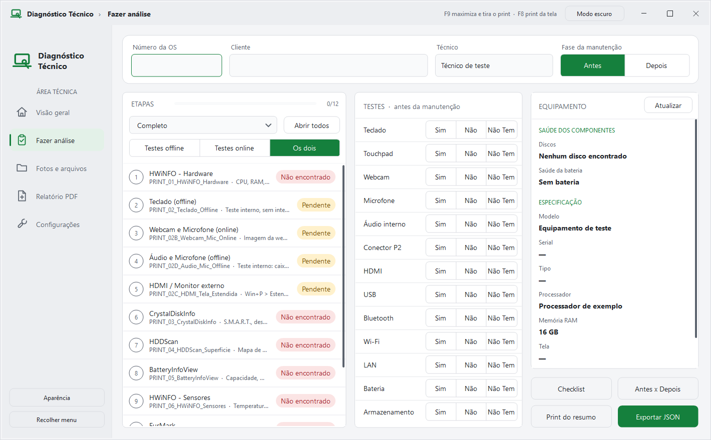

# Diagnóstico Técnico · Cantão

Programa de bancada para análise e triagem de notebooks e computadores. Guia o técnico pelas etapas do diagnóstico, tira os prints já com o nome padronizado, registra os testes funcionais e gera o laudo em PDF.

Roda direto de um pendrive, sem instalação, em Windows 10/11. Inclui adaptações para o Sergei Strelec WinPE (edição de referência: 2026.07.09, x86/x64).



## O que ele faz

- **Etapas guiadas.** Abre cada programa de teste (HWiNFO, CrystalDiskInfo, FurMark...) e mostra o que já foi feito e o que falta.
- **Prints padronizados.** `F9` maximiza a janela e tira o print; `F8` tira o print da tela como está. O arquivo sai como `OS_<número>_PRINT_03_CrystalDiskInfo.png`, sempre em tela inteira, com data e hora visíveis. Print refeito ganha `_2`, `_3`; nada é sobrescrito.
- **Testes sem internet.** Teste de teclado (ABNT2 completo ou notebook compacto) e teste de áudio e microfone embutidos. Dá para escolher entre testes offline, online (sites) ou os dois.
- **Leitura do hardware.** Modelo, serial, processador, memória, tela, saúde dos discos e da bateria.
- **Antes e depois.** Cada OS tem a fase *Antes* e *Depois* da manutenção, com tabela de comparação e observações.
- **Checklist de evidências.** Mostra quais fotos e prints obrigatórios ainda faltam.
- **Relatório em PDF.** Laudo com equipamento, testes, comparação, checklist e uma página por foto ou print.
- **Exportação em JSON** para importar no laudo web da Cantão.

## Como usar

1. Baixe o `DiagnosticoTecnico.exe` e coloque em uma pasta (ou na raiz do pendrive).
2. Abra o programa. Ele pede permissão de administrador, necessária para o CrystalDiskInfo e o HWiNFO.
3. Em **Configurações**, indique a pasta dos programas de teste e clique em **Procurar todos**.
4. Em **Fazer análise**, digite o número da OS e siga as etapas.

Na primeira execução o programa cria o `config.json` ao lado do `.exe`, com as pastas, etapas e preferências. O passo a passo completo está no [LEIA-ME.txt](LEIA-ME.txt).

O programa só fecha pelo botão X da janela (Alt+F4 é bloqueado de propósito, para não fechar no meio de um teste).

## Sergei Strelec WinPE

Extraia o pacote `artifacts/DiagnosticoTecnico-Strelec.zip` no pendrive e abra `Iniciar-WinPE.cmd` depois de iniciar pelo Strelec. O pacote usa caminhos relativos e testes offline. A busca inclui as pastas `SSTR` das unidades montadas e os programas do WinPE. A pasta das OS é verificada para evitar salvar na unidade temporária do PE.

O ambiente precisa de **.NET Framework 4.5 ou superior com Windows Forms**. ASP.NET e PowerShell não são necessários; dados de hardware têm alternativas para WMI indisponível. Drivers de áudio, vídeo, rede e armazenamento continuam dependendo da mídia. Veja [LEIA-ME-WINPE.txt](LEIA-ME-WINPE.txt).

Os testes automatizados simulam os cenários de WinPE no Windows; o boot real na mídia 2026.07.09 ainda precisa ser validado. O .NET do WinPE é um subconjunto do Framework, conforme a [referência da Microsoft](https://learn.microsoft.com/en-us/windows-hardware/manufacture/desktop/winpe-add-packages--optional-components-reference).

Para gerar o pacote portátil sem incluir configurações locais, ferramentas ou dados de clientes:

```powershell
powershell -NoProfile -ExecutionPolicy Bypass -File build-winpe.ps1
```

## Programas de teste

Os programas de terceiros **não vêm neste repositório**. Baixe cada um no site do fabricante e coloque na pasta de programas:

| Etapa | Programa |
|---|---|
| Hardware e sensores | HWiNFO |
| Saúde do disco | CrystalDiskInfo |
| Superfície do disco | HDDScan |
| Escrita (condicional) | H2testw |
| Bateria | BatteryInfoView |
| Estresse de GPU | FurMark |
| Benchmark de GPU | Unigine Superposition |
| Benchmark de CPU | Cinebench |

Etapas sem o programa aparecem como "Não encontrado"; o resto continua funcionando. As etapas são editáveis em **Configurações**.

## Estrutura no pendrive

```
DiagnosticoTecnico.exe
config.json
Ferramentas\          programas de teste
OS\
   12312\
      OS_12312_01_TampaSuperior.jpg
      OS_12312_PRINT_03_CrystalDiskInfo.png
      Documentos\     JSON da OS, arquivos do laudo web e o PDF
      Textos\         relatório do CrystalDiskInfo
```

Use caminhos relativos no `config.json` (`.\Ferramentas\...`, `.\OS`) para o programa funcionar com qualquer letra de unidade.

## Compilar

Não precisa instalar nada: o `build.bat` usa o compilador C# que já vem no Windows (.NET Framework 4).

```bat
build.bat
```

Para rodar os testes automáticos (telas nos dois temas e reconhecimento do teclado):

```powershell
powershell -NoProfile -ExecutionPolicy Bypass -File tests\run.ps1
```

## Requisitos

- Windows 10 ou 11, ou WinPE com .NET Framework 4.5 ou superior e Windows Forms
- Internet apenas para os testes online (teclado e webcam por site)
